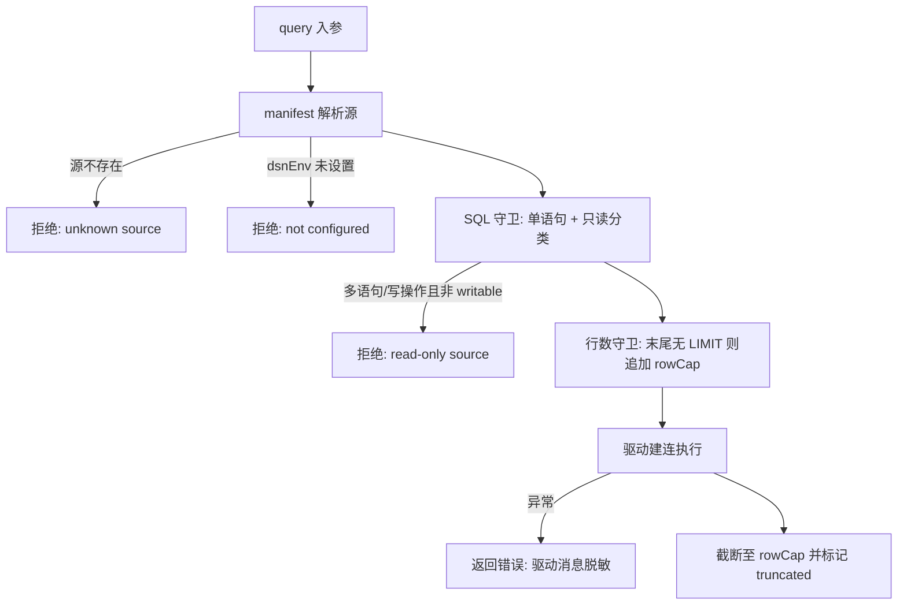

# 数据库调试网关（data 插件）

状态：设计中，2026-10-29。第一阶段范围经计划评审确认：官方 `data` 插件（本地 stdio MCP server）提供受控查询能力；宿主侧数据源注册表、设置页与凭证托管为二期。

## 1. Feature Summary

| 项目          | 内容                                                                                                                           |
| ------------- | ------------------------------------------------------------------------------------------------------------------------------ |
| 已确认需求    | Agent 能对已注册数据源执行查询以辅助调试；默认只读；连接串零明文落配置                                                         |
| 能力 / 变更层 | 新增官方插件 `data`（MCP 工具 `data__list_sources` / `data__describe` / `data__query`）；validation、commit-effect             |
| 工作模式      | 先落本 spec 与失败测试，再实现插件                                                                                             |
| 主要入口      | 插件 `.zcode-plugin/plugin.json` 的 `mcpServers.data` → MCP 工具表 → `ToolScheduler` 审批                                      |
| 实施范围      | 插件包自身（config/guards/drivers/server）、官方 seed 与 SEA 资产注册                                                          |
| 暂不扩展      | 宿主 `IDataSourceService` 与设置页、`ICredentialService` 托管 DSN、`tool_usage` 结构化审计列、MySQL 语句超时、组织级数据源共享 |

## 2. 产品规则

1. **只读由分类器强制，不靠声明**。`data__query` 默认只允许 `SELECT` / `WITH … SELECT` / `EXPLAIN`；多语句、写操作与 DDL 一律拒绝，除非该数据源在 manifest 中显式 `writable: true`。
2. **配置文件零密钥**。manifest 只记录环境变量引用名（`dsnEnv`），运行时解析 `process.env`；连接串本身不写入任何配置文件、日志或工具返回值。
3. **两级 manifest**。用户级 `<plugin-data>/data-sources.json` 与项目级 `<project>/.zcode/data-sources.json`；同名源项目级覆盖用户级。项目级可提交 git，实现团队共享开发库配置、密钥仍走各自环境。
4. **行数上限**。对末尾无 `LIMIT` 的返回行语句（SELECT/WITH/VALUES/TABLE）追加 `LIMIT rowCap + 1`，驱动截断到 `rowCap` 并以多取的那一行精确判定 `truncated`。不返回行的语句（写操作、SHOW、DESCRIBE、EXPLAIN）不追加。
5. **审批与审计复用宿主机制**。所有 MCP 工具每次调用都经 `PermissionService` 审批（`core/src/mcp/index.ts` 对 MCP 工具硬编码 `needsApproval`）；SQL 原文与结果落会话转录 `part` 表，调用元数据落 `tool_usage` 表。第一阶段不扩 schema。
6. **无状态设计**。stdio 插件被进程池 30 秒空闲回收（`adapters/src/mcp/pool.ts`），因此插件按查询建连、不持有跨调用状态，接受冷启动。

## 3. 状态所有者与边界

- **唯一状态所有者**：data 插件进程自身。宿主（services/desktop）不持有任何数据源连接或查询状态；远程与本地 workspace 行为一致。
- **不修改**：agent 核心循环、ZCode 协议、`ToolScheduler` 权限模型、MCP 连接池。插件只作为标准 MCP server 被现有链路加载。
- **插件不写项目文件**：除查询结果经 MCP 协议返回外，插件不产生持久化副作用；manifest 为纯输入。
- **凭证边界**：`dsnEnv` 未设置或解析为空时，`list_sources` 将该源标记为 `unconfigured` 并给出可读原因，`describe`/`query` 拒绝执行；错误信息不得回显连接串值。

## 4. 接口契约

### 4.1 manifest schema（`data-sources.json`）

```jsonc
{
  "sources": [
    {
      "name": "dev-main",            // 唯一名，工具入参引用
      "type": "postgres" | "mysql" | "sqlite",
      "dsnEnv": "DEV_MAIN_DSN",      // 环境变量名；sqlite 时为文件路径
      "readOnly": true,              // 默认 true；false 等价 writable
      "rowCap": 500,                 // 默认 500，最大 10000
      "schemas": ["public"]          // 可选；限定 describe/query 可访问的 schema
    }
  ]
}
```

校验规则：`name` 非空且在同级 manifest 内唯一；`rowCap` 为正整数；`type` 为三者的枚举；`schemas` 缺省表示不限制。非法条目整份拒绝加载并在 `list_sources` 的错误段报告，不静默跳过。

### 4.2 工具

| 工具                 | 入参                       | 返回                                                                                        |
| -------------------- | -------------------------- | ------------------------------------------------------------------------------------------- |
| `data__list_sources` | 无                         | 每源的 `{ name, type, readOnly, rowCap, schemas?, configured }`；**不含** `dsnEnv` 与连接串 |
| `data__describe`     | `{ source }`               | `{ source, tables: [{ name, columns: [{ name, type, nullable }] }] }`，受 `schemas` 限制    |
| `data__query`        | `{ source, sql, params? }` | `{ source, columns, rows, rowCount, truncated, durationMs }`                                |

`data__query` 执行顺序（确定性管道，无隐藏分支）：



## 5. 交互与顺序

1. 用户在 manifest（用户级或项目级）登记数据源，连接串经环境变量提供。
2. Agent 调 `data__list_sources` 发现可用源；`unconfigured` 源不可用于后续工具。
3. `data__describe` 内省结构，辅助写正确 SQL。
4. `data__query` 执行；每次调用经 `PermissionService` 审批（yolo/guarded 或项目 allow 规则可免确认，README 说明配法）。
5. 结果行数达 `rowCap` 时标记 `truncated`，agent 应追加精确条件而非假设结果完整。

## 6. 验收场景

| #   | 场景                                | 预期                                                         |
| --- | ----------------------------------- | ------------------------------------------------------------ |
| A1  | sqlite 源（临时库）三工具全流程     | list → describe → query 均成功，行数与表内容一致             |
| A2  | 只读源执行 `INSERT`/`UPDATE`/`DROP` | 拒绝，错误说明只读策略                                       |
| A3  | 只读源执行 `SELECT 1; SELECT 2`     | 拒绝（多语句）                                               |
| A4  | 无 `LIMIT` 查询且行数超过 `rowCap`  | 返回 `rowCap` 行且 `truncated: true`                         |
| A5  | 语句末尾已有 `LIMIT`                | 不重复追加                                                   |
| A6  | `dsnEnv` 指向未设置变量             | `list_sources` 标记 `unconfigured`；`query` 拒绝且不含变量值 |
| A7  | 项目级与用户级同名源                | 项目级覆盖用户级                                             |
| A8  | 未知源名 / manifest 非法条目        | 可读错误，不静默跳过                                         |
| A9  | `writable: true` 源执行写操作       | 允许执行（仍走审批），且仅该源如此                           |

## 7. 验证

- 插件包单测覆盖分类器、LIMIT 追加、行数截断、manifest 合并与校验。
- 以 `node:sqlite` 临时库做真实 MCP 协议往返的集成测试（A1–A5、A7、A8）。
- `pnpm typecheck`、`pnpm lint`、`pnpm architecture:check --changed` 真实执行并如实报告。
- 版本号在 `package.json` / `.zcode-plugin/plugin.json` / `official-plugin-definitions.ts` / `sea-official-plugin-assets.mjs` 四处对齐（既有 build-sea 测试强制）。
